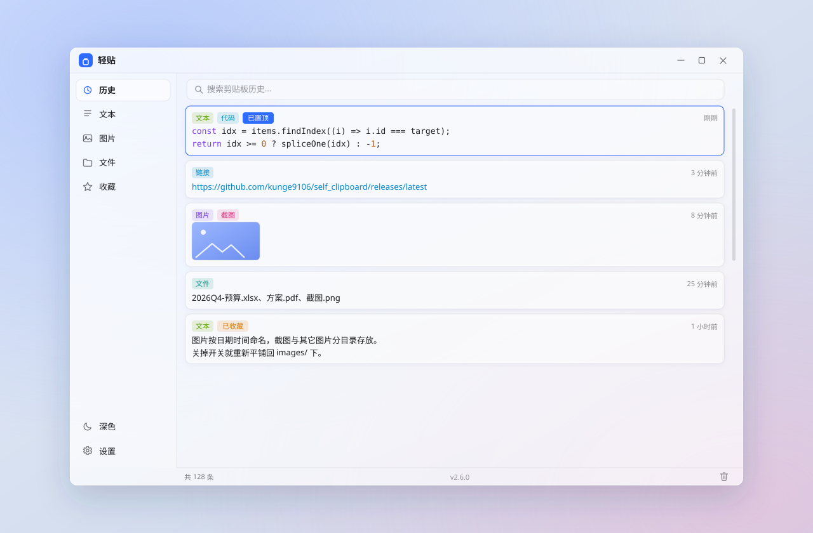

<div align="center">
  
  <p><b>复制过的东西，随时找回来。</b><br/>文本、图片、文件全部留在本机，安全、干净、即取即用。</p>

  <p>
    <a href="https://github.com/kunge9106/self_clipboard/releases/latest"></a>
    
    
    
    
  </p>
</div>

---

## 这是什么

**轻贴**是一款 Windows 桌面剪贴板历史管理器。它安静地待在托盘里，把你复制过的每一条内容记下来——文本、图片、文件——需要的时候打开窗口，搜一下、点一下，内容就回到剪贴板了。

它是一个**单机小工具**：没有账号、没有云端。所有内容都写在你自己指定的目录里，随时可以打开看、随时可以清掉。**你复制的内容永远不出本机**——唯一的对外请求是「关于」页的检查更新（只读取 GitHub 上的公开版本信息，不带任何标识、不上传任何数据）。

> **轻**是字面意思：安装包 **1.4 MB**，常驻内存约 **120 MB**（同类 Electron 方案的安装包通常在 80–150 MB）。上一代基于 Electron 的 v1 安装包是 89 MB，这一代缩小了约 70 倍。

## 界面预览



左侧是分类导航，右侧是搜索框 + 历史列表，底部是条数与版本。卡片上右键就能复制、置顶、收藏、删除。

## 功能

**采集**

- 文本、图片、文件（资源管理器里复制的文件）
- 微信 / QQ 里复制的图片会自动记为**图片**条目——它们放进剪贴板的是临时图片文件而非位图，轻贴会解码后按图片存
- 事件驱动监听，不是轮询——空闲时几乎不占 CPU
- 内容全部落盘，内存里只保留索引元数据

**查找**

- 实时搜索，文本正文、文件名、**类型名**都能命中（搜「图片」或 `image` 都会出图片条目）
- 五个分类：历史 / 文本 / 图片 / 文件 / 收藏
- 置顶**按分类独立**：在「文本」里置顶，不会影响它在「历史」里的位置
- 卡片徽章：类型、已置顶、已收藏、已失效一眼可辨，时间在右侧对齐成一列

**整理**

- 收藏与置顶，清理历史时自动豁免
- 保留天数可调（0 = 永久保留，设置页会显示「永久保存」）
- 缓存目录可迁移，实时显示占用大小；选到空目录直接用，选到**非空目录**会在其下自动建一个缓存子文件夹，不污染你原有的内容
- 文件条目失效检测：原文件被移动或删除会标「已失效」，点击时明确告诉你跳过了哪几个
- **危险操作二次确认**：「清空全部历史」会写明条数并提示「含置顶与收藏、不可撤销」；工具栏垃圾桶在范围内有置顶/收藏时才弹窗，让你勾选是否一起清

**外观**

- 跟随系统深色模式
- 「材质浓度」滑块，实时调节窗口通透度
- 「圆角模式」开关，在圆角通透与直角毛玻璃之间切换（见下）

**设置**

- 按 **通用 / 外观 / 记录与缓存 / 关于** 四个标签分页，找项不用翻长列表
- 覆盖安装时会在欢迎页写明旧版本 → 新版本，并提醒先退出运行中的轻贴

**关于**

- 一页看全**运行环境自检**：系统版本与 build、实际生效的材质档位、圆角模式、开机自启、当前内存占用、缓存目录
- **检查更新**：直接读取 GitHub Release 的更新日志并就地渲染（自动探测可用代理，不开代理也能直连尝试）
- 一键打开项目主页 / 提交问题反馈

**稳定与排查**

- **单实例**：同一版本只允许开一个；再次双击会把已运行的窗口带到前台。测试版与正式版使用不同的锁，可以共存（方便双版本对比）
- **全局日志**：所有日志落盘到缓存目录 `log/轻贴.log`，超过 64 MB 自动截半保尾；程序崩溃时另存一份带时间戳的日志快照。遇到问题把这个文件发出来就能定位
- 日志文件名为 `轻贴.log` / `轻贴-崩溃_<时间戳>.log`

**后台**

- 托盘图标常驻，右键菜单与主界面同一套样式与材质
- 开机自启
- 关闭时后台运行（隐藏到托盘，而不是退出）
- 退出时可自动清理缓存，可选是否连置顶/收藏一起清

## 下载安装

前往 [Releases](https://github.com/kunge9106/self_clipboard/releases/latest) 下载 `light_clip_v2.1.8_setup.exe`，双击安装即可。

- 安装器为中文界面。
- 双击后会**自动请求管理员权限**（弹一次 UAC 确认），因为默认安装到 Program Files。旧版安装器不申请权限，装到 Program Files 会报「无法打开要写入的文件」，需手动右键以管理员运行——v2.1.5 起不再需要。
- 需要 **Windows 10 (1809) 或更高版本**。
- 安装包使用 WebView2 **在线引导**模式。Win11 与较新的 Win10 已内置 WebView2；若系统没有，安装时会联网下载引导包。

## 快速上手

1. 安装后从开始菜单或托盘打开轻贴，窗口会显示当前已记录的内容（首次为空）。
2. 随便复制一段文字或一张图片，回到窗口即可看到新条目。
3. 在条目上**右键**：复制 / 置顶 / 收藏 / 删除。
4. 想找东西就在顶部搜索框打字。
5. 想记录资源管理器里复制的文件，去 **设置 → 记录与缓存 → 文件复制** 打开开关（默认关闭）。

> **关于「文件复制」默认关闭**：文件条目记录的是文件路径引用，而不是文件副本；原文件被移动或改名后就粘不出来了。因为它牵涉真实磁盘路径，默认不采集，需要时再打开。

## 材质与圆角

窗口材质按系统版本自动分档，启动时会在终端打印**实际生效**的档位（不接受「调用没报错就算成功」）：

| 系统 | build | 材质 | 圆角上限 |
|---|---|---|---|
| Win11 22H2+ | ≥ 22621 | `DWMWA_SYSTEMBACKDROP_TYPE` 系统级 acrylic | 12px（系统圆角） |
| Win11 21H2 | 22000 | Mica | 12px（系统圆角） |
| Win10 1809 – 22H2 | 17763 – 19045 | `SetWindowCompositionAttribute` 真·acrylic | 20px |
| 更低版本 / 调用失败 | — | 不透明兜底 | 12px |

在 Win10 上，「圆角」和「系统模糊」有个无法同时满足的地方：acrylic 始终铺满**窗口矩形**，`SetWindowRgn` 对它无效，所以圆角越大，四角露出的方形模糊就越多。轻贴把这个取舍交给你：

- **圆角模式（开）**：关掉系统模糊，窗口四角真透明、100% 干净，代价是背后的壁纸不再被模糊。
- **直角模式（默认）**：保留系统毛玻璃，窗口用直角，矩形与 acrylic 完全吻合，同样没有任何残留。

## 开发

**环境要求**

- Rust（stable，MSVC 工具链）
- Node.js 18+
- WebView2 Runtime

> 注意：本项目在 Windows 上**使用系统 Node**（而非某些托管环境自带的 Node）构建前端，托管 Node 调用 esbuild 时可能因 `spawnSync` 被拦截而 `EBUSY` 失败。

```bash
# 安装前端依赖
npm install

# 开发运行（自动拉起 Vite 与 Tauri 窗口）
npm run tauri:dev

# 构建安装包（产物在 src-tauri/target/release/bundle/nsis/）
npm run tauri:build
```

**技术栈**

| 技术 | 用途 |
|---|---|
| Tauri 2 | 桌面框架（Rust + 系统 WebView2） |
| Rust | 剪贴板监听、窗口材质、存储、托盘 |
| 原生 HTML / CSS / JS | 前端，无框架 |
| Vite | 前端开发服务器与打包 |

**目录结构**

```
self_clipboard/
├─ src/                     前端（原生 HTML/CSS/JS）
│   ├─ main.js              主界面逻辑：渲染、搜索、右键菜单、设置
│   ├─ styles.css           主界面样式（材质变量、深色模式）
│   ├─ tray.js / tray.css   托盘右键菜单页
│   └─ assets/logo.png
├─ index.html               主窗口入口
├─ tray.html                托盘菜单窗口入口
├─ src-tauri/
│   ├─ src/
│   │   ├─ lib.rs           应用装配与 IPC 命令注册
│   │   ├─ clipboard.rs     剪贴板监听、多格式解析、存储与清理
│   │   ├─ effects.rs       Windows 材质分档、圆角、自定义拖动/缩放
│   │   ├─ singleton.rs     单实例约束（按版本区分锁名）
│   │   ├─ logger.rs        全局日志（println/eprintln 落盘 + 崩溃快照）
│   │   ├─ about.rs         关于页：环境自检、检查更新
│   │   ├─ settings.rs      config.json 持久化
│   │   ├─ tray.rs          托盘图标与自绘菜单窗口
│   │   └─ autostart.rs     开机自启（注册表）
│   └─ tauri.conf.json      窗口、打包、WebView2 参数
├─ assets/readme/           README 用的图
├─ DESIGN.md                设计文档（架构、材质取舍、决策记录）
└─ CODE_REVIEW.md           v1（Electron）的代码审查结论
```

## 数据存在哪

默认目录是 `%APPDATA%\com.kunge.selfclipboard\clipboard\`，可在设置里改成任意路径：

```
clipboard/
├─ index.json        索引：id / 类型 / 预览 / 时间 / 置顶与收藏 / 大小
├─ data/<id>.txt     文本正文
├─ images/<id>.bmp   图片
├─ files/<id>.txt    文件清单（每行一个完整路径）
└─ log/              日志（轻贴.log；崩溃时另存 轻贴-崩溃_<时间戳>.log）
```

内存里只保留索引元数据；正文、图片、文件清单都按需从磁盘读取，列表滚出视野后即释放。删除条目、清理缓存、退出清理都会同步清掉对应的落盘文件。

## 路线图

v2.1 已经可用，后续仍在推进：

- [x] 文本 / 图片 / 文件采集，分类浏览与搜索
- [x] 收藏、按分类独立的置顶、保留天数
- [x] 托盘常驻与自绘菜单、开机自启
- [x] Win10/11 分档材质、材质浓度、圆角模式
- [x] 内存优化（渐进渲染、图片降采样、视野外释放位图）
- [x] 设置页分类标签、卡片徽章、搜索类型名、危险操作二次确认
- [x] 微信 / QQ 复制的图片自动记为图片条目
- [x] 圆角模式开关按档位正确切换材质、缓存目录迁移防自我嵌套
- [x] 关于页（运行环境自检、检查更新与更新日志）
- [x] 单实例约束、全局日志与崩溃快照
- [ ] 全局快捷键唤出
- [ ] 快捷面板形态（光标附近弹出、Enter 直接粘贴回原窗口）
- [ ] 富文本（CF_HTML / RTF）与链接识别
- [ ] 隐私排除（按来源进程跳过密码管理器等）
- [ ] 列表虚拟滚动（应对十万条量级）

## 常见问题

**托盘图标在哪？**
程序一运行就在，始终常驻。右键出菜单（显示轻贴 / 退出），双击唤回窗口。

**为什么内存不是几十 MB？**
窗口由系统 WebView2 渲染，多进程模型本身就有基础开销；在保证观感（真毛玻璃、图片缩略图）的前提下已尽量压到底。

**点了文件条目却提示找不到文件？**
文件条目存的是路径引用，不是副本。原文件被移动、改名或删除后就失效了——界面会把它标成「已失效」，点击时也会告诉你跳过了哪几个。

**能在 Win7 上用吗？**
不能。最低 Windows 10 1809。

**安装时报「无法打开要写入的文件」？**
v2.1.0 及更早的安装器不申请管理员权限，装到 Program Files 就会报这个（需手动右键以管理员运行）。v2.1.5 起双击即自动弹 UAC 确认，不再出现。

**Win11 上切「圆角模式」怎么没看到边角变化？**
Win11 的 DWM 本身就给顶层窗口圆角，所以开不开圆角模式边角都是圆的；这个开关真正改变的是**背景模糊与材质观感**（设置页该项已注明）。圆角半径统一跟随系统原生值——`DWMWA_WINDOW_CORNER_PREFERENCE` 只提供定性选项，无法指定具体像素。

**双击图标怎么好像「没反应」？**
轻贴是**单实例**的：同一版本已经在运行时，第二次启动会把已有窗口直接带到前台，不会再开一个。（测试版与正式版锁名不同，可以共存。）

**崩溃或行为异常，怎么反馈？**
去缓存目录的 `log/` 下拿 `轻贴.log`；如果程序崩过，还会另存一份 `轻贴-崩溃_<时间戳>.log`，把这个文件发到 [Issues](https://github.com/kunge9106/self_clipboard/issues) 即可定位问题。

**「关于」页的检查更新能连上吗？**
它调用系统自带的 `curl.exe` 访问 GitHub，会先试你系统里登记的代理端口、再试直连，全部失败才会提示检查网络。首次检查可能要等几秒。

## 贡献

欢迎提 Issue 与 PR。仓库采用 **GitHub Flow**：`main` 只经 PR 合入，功能/修复开 `feature/*`、`fix/*` 分支；提交信息遵循 [Conventional Commits](https://www.conventionalcommits.org/)；合并用 `--no-ff` 保留合并节点，便于整段回退。

完整的分支 / 提交 / 双机开发 / 发版流程见 **[CONTRIBUTING.md](./CONTRIBUTING.md)**。

## 开源协议

[MIT](./LICENSE) © 2026 kunge9106

可自由使用、修改、分发（含商用），只需保留版权声明与许可声明。

## 致谢

- [Tauri](https://tauri.app/) —— 让「小安装包 + 原生能力」成为可能
- 窗口材质的实现参考了大量社区实证（`SetWindowRgn` 对 acrylic 无效、Win10 accent API 只有单色 tint 等），相关结论记录在 [DESIGN.md](./DESIGN.md) 的决策记录中
